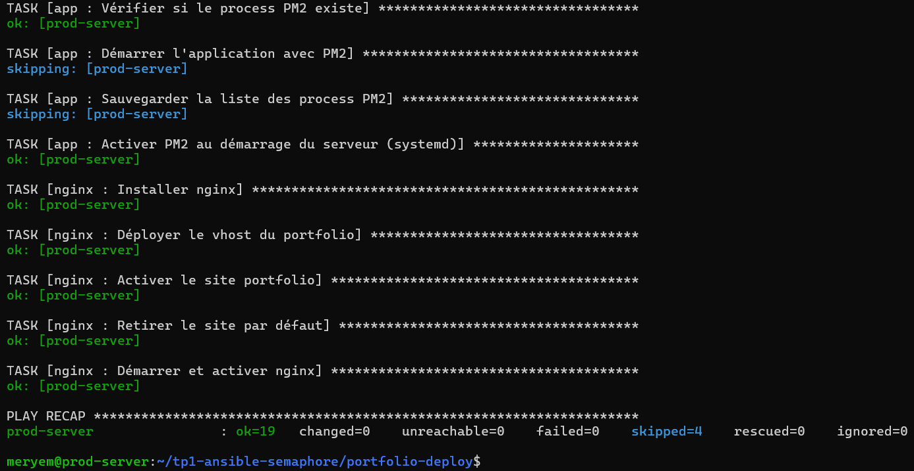
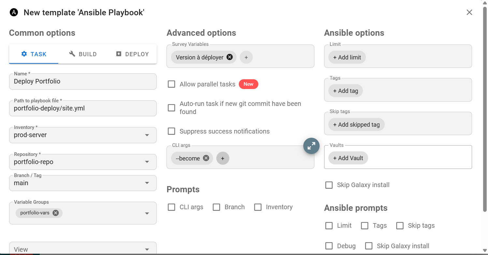
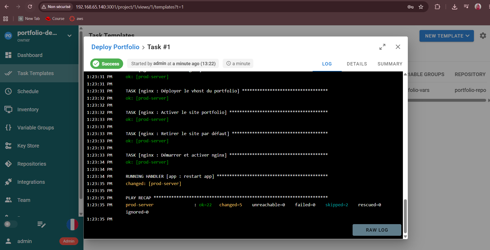
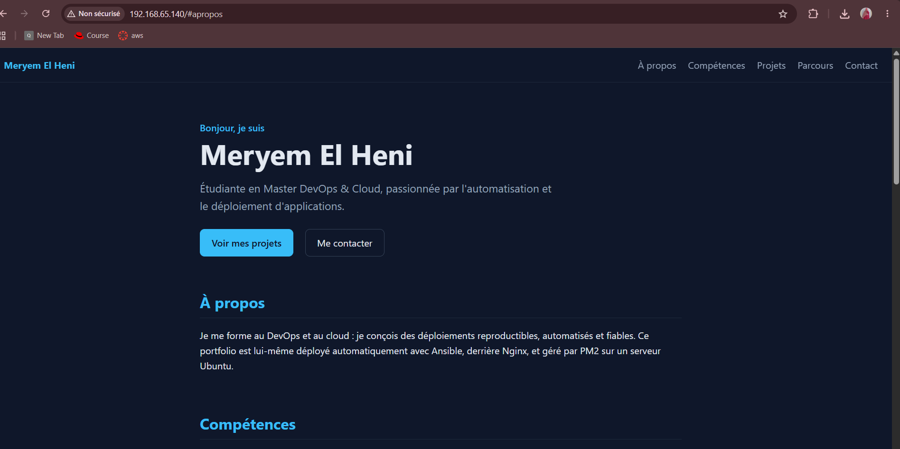

# Rapport TP1 : Déploiement d'un portfolio Next.js avec Ansible et Semaphore UI

**Étudiante :** Meryem El Heni — Master DevOps & Cloud (M2)

## 1. Objectif et architecture

J'ai déployé un portfolio Next.js sur un serveur Ubuntu avec un playbook Ansible structuré en quatre rôles (`common`, `nodejs`, `app`, `nginx`), puis j'ai industrialisé son exécution avec Semaphore UI.

- **Serveur :** VM VMware (Ubuntu Server 26.04 LTS, réseau NAT, IP `192.168.65.140`).
- **Application :** Next.js (Node.js 22) lancée par **PM2** sur le port 3000, derrière **Nginx** (port 80, reverse proxy).
- **Code :** dépôt GitHub public `meryemelheni/partie-1-tp1-3`.
- **Semaphore UI :** deux conteneurs Docker (Semaphore + PostgreSQL), port 3001.

## 2. Partie A : le playbook Ansible

- **common :** mise à jour du cache apt, paquets de base (`git`, `curl`, `build-essential`), création de l'utilisateur `deploy`.
- **nodejs :** dépôt NodeSource (clé GPG), installation de Node.js et de PM2.
- **app :** clonage du dépôt, `npm ci` et `npm run build` seulement si le code a changé, démarrage via PM2, activation au démarrage (systemd). Le handler `restart app` redémarre l'application uniquement quand le dépôt a été mis à jour.
- **nginx :** installation, template Jinja2 du vhost, activation du site, retrait du site par défaut, handler `reload nginx`.

**Validation.** Le `--syntax-check` est valide. La 1ʳᵉ exécution s'est terminée sans erreur (`changed=18`). La 2ᵉ exécution affiche **`changed=0`** : le playbook est idempotent, car les commandes ne s'exécutent que si leur résultat n'existe pas encore (`when`, `creates`) et les handlers ne sont notifiés qu'en cas de changement réel.

## 3. Partie B : Semaphore UI

Objets configurés : une clé SSH (Key Store), le dépôt Git (Repository), l'inventaire statique `prod-server`, un groupe de variables `portfolio-vars` (`server_name`, `app_port`, `app_dir`), puis le Task Template **Deploy Portfolio** (`portfolio-deploy/site.yml`, argument `--become`, survey `app_version` valant `main` par défaut).

La 1ʳᵉ tâche s'est terminée en **Success** (`failed=0`). J'ai ensuite modifié le texte d'accueil de `app/page.js`, poussé le commit puis relancé la tâche : Ansible a mis à jour le dépôt, reconstruit l'application, et le handler **`restart app`** s'est déclenché (`changed`). Le portfolio affiche bien la modification.

## 4. Difficultés rencontrées et solutions

| Problème | Cause | Solution |
|---|---|---|
| La VM n'avait pas d'IPv4 | Fichier netplan sans `dhcp4: true` (réseau en pont inactif en wifi à l'installation) | Passage en NAT et ajout de `dhcp4: true` |
| WSL ne s'installait pas | Téléchargement coupé par une connexion wifi instable | Ansible installé directement sur la VM (connexion `local`) |
| Erreur de callback `yaml` | Plugin supprimé de `community.general` 12 | `stdout_callback = default` avec `callback_result_format = yaml` |
| `ansible.cfg` ignoré | Dossier accessible en écriture à tous | `chmod -R go-w` |
| `sudo` bloquait Ansible | Mot de passe exigé | Règle `NOPASSWD` pour mon utilisateur (VM de TP) |
| Semaphore plantait (`unknown store type`) | Base `bolt` non acceptée par l'image `latest` | Base PostgreSQL dans un second conteneur |

## 5. Bilan

Le déploiement est automatisé, reproductible et idempotent, puis exécutable depuis une interface avec suivi des logs. Les points à améliorer en production : HTTPS avec Let's Encrypt, un `sudo` limité aux commandes nécessaires, des secrets chiffrés (Ansible Vault) et un déclenchement automatique par webhook.
