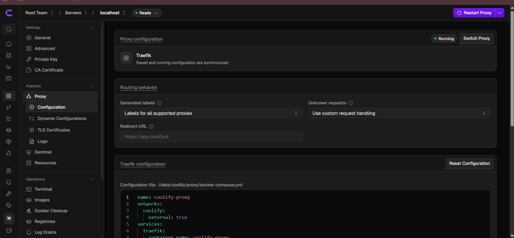
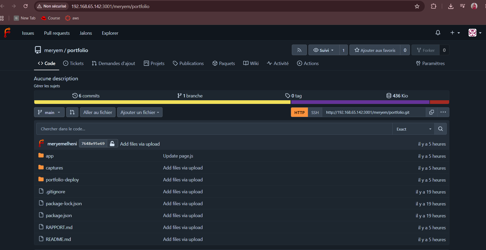
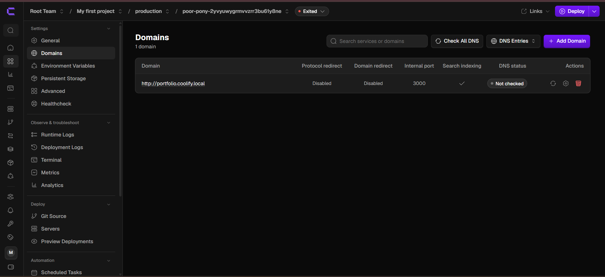
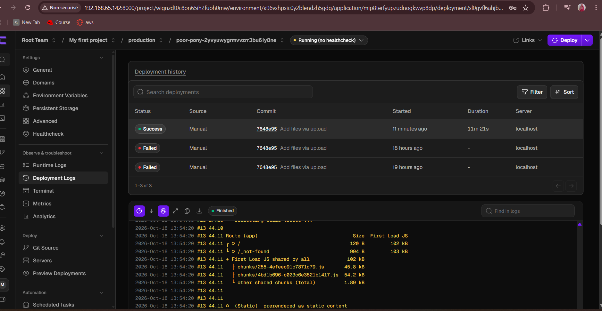
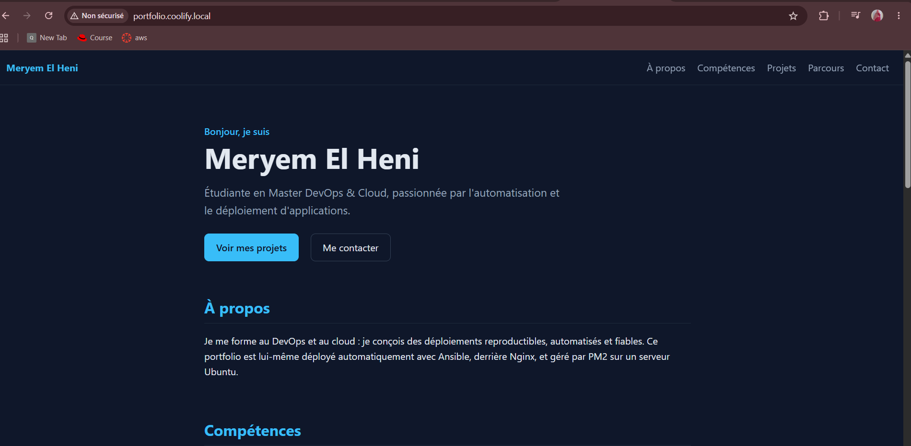
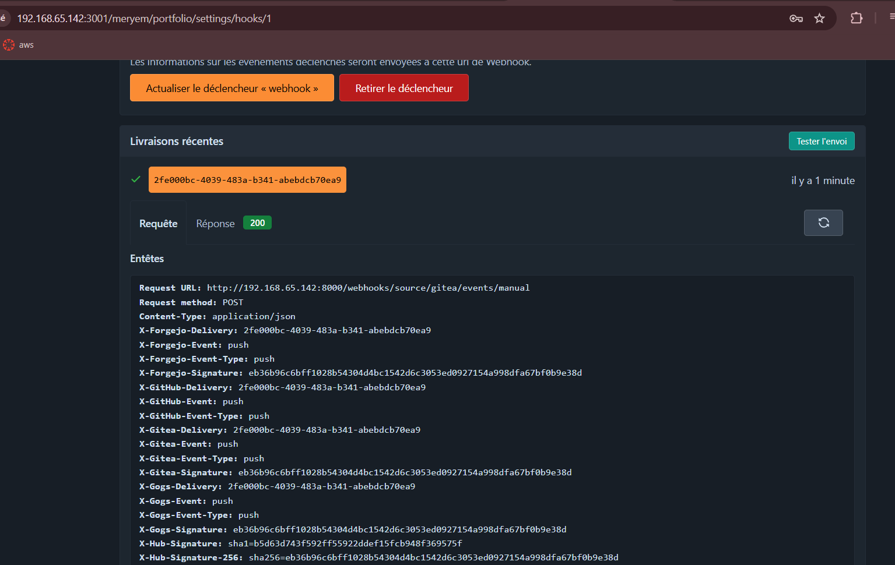
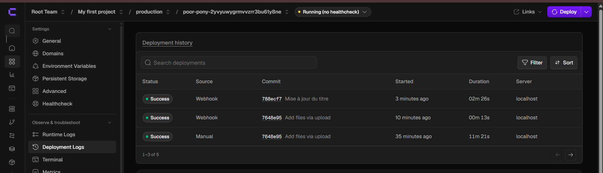
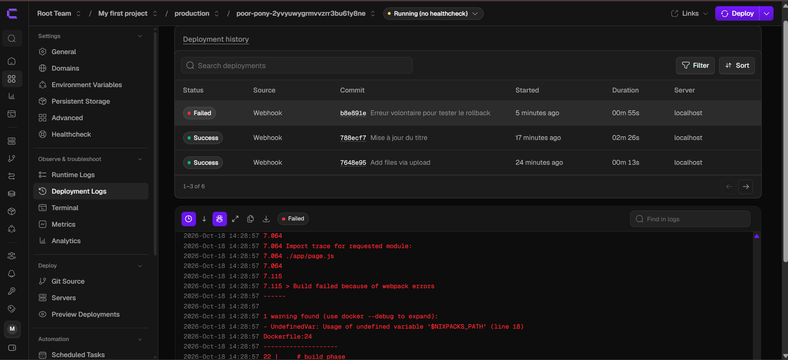

# Rapport TP2 : Déploiement d'un portfolio Next.js avec Coolify et Forgejo

**Étudiante :** Meryem El Heni — Master DevOps & Cloud (M2)

## 1. Environnement et architecture

- **VM dédiée** (VMware) : Ubuntu Server 24.04 LTS, 2 vCPU, 4 Go de RAM, disque de 20 Go, réseau NAT, IP `192.168.65.142`.
- **Coolify v4.4.6** (PaaS auto-hébergé) installé avec le script officiel, avec son proxy **Traefik** (ports 80/443).
- **Forgejo 16** (forge Git) lancé avec Docker Compose, interface sur le port **3001**, base SQLite.
- **Nom d'hôte local** `portfolio.coolify.local`, déclaré dans le fichier `hosts` de mon poste Windows (aucun DNS ni domaine public).
- **Application :** le portfolio Next.js du TP1, hébergé dans le dépôt Forgejo `meryem/portfolio`, construit par **Nixpacks** (Node 22) et exposé sur le port 3000.

## 2. Partie A : installation de Coolify

L'installation a pris 8 min 30 s. J'ai créé le compte administrateur, choisi le serveur `localhost`, puis démarré le proxy (Servers → Proxy) : le serveur est **Reachable** et le proxy **Running**.

## 3. Partie B : Forgejo et dépôt

Forgejo est déployé à partir du `docker-compose.yml` fourni. J'ai vérifié deux points : le port web **3001** (le 3000 reste pour Next.js) et la variable `FORGEJO__webhook__ALLOWED_HOST_LIST=external,private`, nécessaire pour que Forgejo accepte d'appeler Coolify, qui est sur une adresse privée. J'ai ensuite créé le dépôt public `portfolio` et y ai poussé le code avec `git push`.

## 4. Partie C : déploiement

Dans Coolify : source *Public Repository* (`http://192.168.65.142:3001/meryem/portfolio.git`, avec l'IP car Coolify ne connaît pas mon fichier `hosts`), branche `main`, Build Pack Nixpacks, port 3000, domaine `http://portfolio.coolify.local` (préfixe `http://` pour éviter une demande de certificat). Le premier déploiement a duré **11 min 21 s** ; `curl -I` renvoie `200 OK`.

## 5. Partie D : webhook et rollback

**Webhook.** Dans Coolify, j'ai utilisé l'URL du bloc *Gitea* avec son secret, en remplaçant l'IP publique affichée par l'IP de la VM. Dans Forgejo, j'ai créé le webhook (POST, `application/json`, événement push, branche `main`). La livraison de test renvoie **200**.

**Redéploiement automatique.** J'ai changé un texte de la page, puis fait `git push` : Coolify a lancé seul un déploiement (source *Webhook*, commit « Mise à jour du titre »), terminé en **2 min 26 s** grâce au cache de build, et le site a affiché la modification.

**Échec volontaire et retour arrière.** J'ai poussé une ligne invalide dans `app/page.js`. Le build a échoué (`Syntax Error`, `Build failed because of webpack errors`) et le déploiement est passé en **Failed**. Pendant ce temps, le site continuait de répondre `200 OK`, car Coolify garde l'ancien conteneur tant que le nouveau build n'a pas réussi. J'ai ensuite annulé l'erreur avec `git revert` puis `git push` : le webhook a déclenché un nouveau déploiement réussi avec la version saine.

## 6. Difficultés rencontrées

| Problème | Cause | Solution |
|---|---|---|
| Installation de la VM interrompue (« espace insuffisant ») | Disque `C:` de mon PC saturé | Suppression d'ISO et de fichiers inutiles |
| Disque de la VM plus petit que prévu | LVM d'Ubuntu n'utilisait que la moitié du disque | `lvextend -r` puis `resize2fs` |
| `permission denied` sur Docker | Utilisateur absent du groupe `docker` | `usermod -aG docker`, reconnexion |
| Téléchargement de l'image Forgejo coupé | Wifi instable | Boucle `until docker compose pull` |
| `portfolio.coolify.local` pointait vers une autre machine | Ma ligne ajoutée au fichier `hosts` s'est collée à la ligne précédente | Séparation des lignes, vidage du cache DNS |
| Domaine proposé en `sslip.io` | Coolify génère un domaine à partir de l'IP publique | Remplacé par `portfolio.coolify.local`, protocole `http` |
| Proxy « Attention required » | Proxy non démarré côté Coolify | Bouton *Start Proxy* |
| Déploiements `Failed` sans message | Arrêt du PC et de la VM pendant le build | Ajout d'un swap de 2 Go, relance du déploiement |
| URL du webhook injoignable | Coolify affiche l'IP publique | Utilisation de l'IP locale de la VM |

Les logs ont aussi montré un avertissement npm : la version `next@15.5.4` a une faille de sécurité connue (CVE-2025-66478). Elle ne bloque pas le build, mais il faudrait mettre Next.js à jour.

## 7. Comparaison avec le TP1 (Ansible + Semaphore)

| Critère | TP1 : Ansible + Semaphore | TP2 : Coolify + Forgejo |
|---|---|---|
| Approche | Infrastructure as Code : on décrit l'état voulu du serveur dans des rôles | PaaS : on décrit l'application, la plateforme gère le reste |
| Mise en place | Rédiger et déboguer un playbook (4 rôles) | Installer Coolify (une commande) puis tout configurer par l'interface |
| Ce qui est géré | Le serveur entier (paquets, Node, Nginx, PM2) | Le build, le conteneur, le proxy et le routage |
| Reproductibilité | Très bonne : le playbook est versionné et idempotent (`changed=0`) | Moyenne : la configuration vit dans l'interface de Coolify |
| Déclenchement | Manuel dans Semaphore (ou planifié) | Automatique : webhook à chaque `git push` |
| Rollback | À refaire en déployant une ancienne version du code | Ancien conteneur conservé tant que le build échoue, retour par `git revert` |
| Ressources | Légères (Nginx + PM2) | Plus lourdes (Coolify, Traefik, Postgres, Redis, builds Docker) |
| Flexibilité | Maximale : on contrôle tout le système | Limitée à ce que Coolify propose |
| Courbe d'apprentissage | Plus longue (YAML, modules, idempotence) | Plus courte, mais beaucoup de comportements « cachés » |

## 8. Bilan

Les deux approches sont complémentaires. Ansible convient pour préparer et maintenir un serveur de façon reproductible. Coolify est bien plus rapide pour déployer des applications et offre le déploiement continu sans écrire de code. Le point qui m'a le plus marqué est le comportement du déploiement automatique : un mauvais commit ne casse pas la version en ligne. Pistes d'amélioration : HTTPS avec un vrai domaine, dépôt privé avec clé de déploiement, notifications à chaque déploiement, et mise à jour de Next.js.
